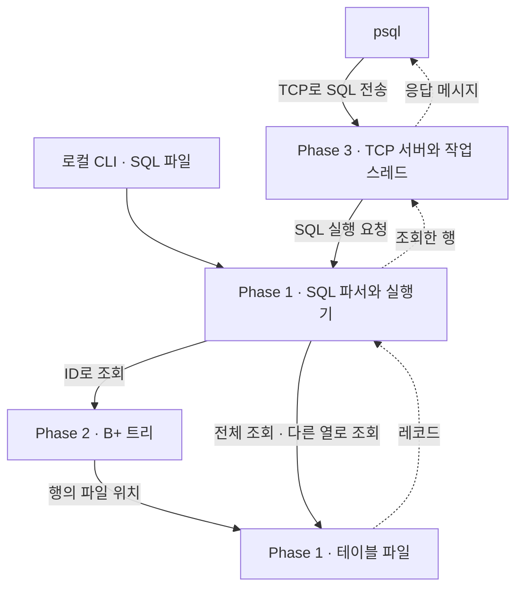

# Datom · 미니 DBMS

Datom은 SQL 파일을 로컬에서 실행하거나 `psql`로 TCP 서버에 접속해 쓸 수 있는 Python 미니 DBMS다. 두 방식 모두 같은 SQL 파서, 실행기, 인덱스와 테이블 파일을 사용한다.

## 클라이언트 요청은 어디로 가나?



예를 들어 `psql`에서 `SELECT name FROM users WHERE id = 2;`를 보내면 작업 스레드가 SQL 엔진을 호출한다. 실행기는 B+ 트리에서 2번 행의 파일 위치를 찾아 `name`을 읽는다. 서버는 열 정보와 결과 행을 돌려주고, `psql`이 이를 화면에 표시한다. 로컬 CLI에서는 SQL 파일을 읽어 같은 엔진을 직접 호출한다.

## Phase별 구현

| 단계 | 담당하는 일 | 코드 |
|---|---|---|
| Phase 1 · SQL 처리기와 저장 | CLI가 SQL 파일을 읽고 파서가 `INSERT`, `SELECT`를 분석한다. 실행기는 사전 정의된 `users(id, name, email)`과 `products(id, name, sku)`를 별도 파일에 저장하고 읽는다. | [CLI](datom/cli.py) · [파서](datom/sql.py) · [실행기](datom/engine.py) |
| Phase 2 · B+ 트리 인덱스 | 삽입할 때 테이블별 ID를 발급하고 ID와 파일 위치를 메모리 B+ 트리에 등록한다. ID 일치 조건은 인덱스로, 다른 열의 조건은 파일 순회로 처리한다. 재시작할 때 파일에서 인덱스를 복원한다. | [B+ 트리](datom/bptree.py) |
| Phase 3 · TCP 서버와 동시성 | 서버가 `selectors`로 연결을 감시하고 수신할 메시지가 있는 연결만 고정 스레드 풀에 맡긴다. 같은 연결의 요청은 순서대로 처리한다. 같은 테이블의 쓰기는 직렬화하며, 진행 중인 조회는 시작 시점까지 저장된 행을 읽는다. | [TCP 서버](datom/server.py) · [PostgreSQL 프로토콜](datom/pgwire.py) |

고정된 `threading.Thread` 작업 스레드가 요청을 나눠 처리한다. 기본 CPython의 GIL로 CPU 연산의 병렬 실행에는 제약이 있으며, 네트워크·파일 I/O 대기 중에는 다른 요청을 처리할 수 있다. [Python threading 문서](https://docs.python.org/3/library/threading.html)

## 실행해 보기

macOS·Linux의 Python 3.9 이상에서 실행한다. 외부 패키지 설치 없이 표준 라이브러리만 사용한다. 빈 데이터 디렉터리에서 예제 파일을 실행하면 Ada와 Grace가 저장된다. 이어서 같은 디렉터리로 서버를 시작한다.

```sh
python3 -m datom --data ./data -f examples/users.sql
python3 -m datom.server --data ./data --port 5433 --workers 4
```

다른 터미널에서 다음 조회를 실행하면 `Grace`가 반환된다.

```sh
psql -X -d 'host=127.0.0.1 port=5433 dbname=datom user=learner sslmode=disable' \
  -c 'SELECT name FROM users WHERE id = 2;'
```

서버는 로컬 개발용 평문 TCP와 PostgreSQL 3.0 Simple Query를 지원한다. 한 요청에서 SQL 한 문장을 실행하며 TLS, 비밀번호 인증, prepared statement, 여러 문장에 걸친 트랜잭션은 지원 범위 밖이다.

## 검증과 성능

`make test`로 단위·통합 테스트를, `make test-psql`로 실제 클라이언트 접속을 검증한다. 클라이언트 테스트에는 `psql`이 필요하며 실행 경로는 `make test-psql PSQL=/path/to/psql`로 지정할 수 있다. Make 없이 `python3 -m unittest discover -s tests`, `python3 tests/integration.py`로도 테스트할 수 있다.

`make bench`는 SQL로 100만 행을 삽입한 뒤 같은 행을 ID와 이름으로 각각 조회한다. 두 경로를 예열한 뒤 고정 시드로 선택한 31개 행에 대해 결과값과 검사 행 수를 함께 검증한다. 측정 범위는 SQL 파싱과 엔진 실행이다. [벤치마크 코드](bench/benchmark.py)

Apple M4 · CPython 3.9.6에서 100만 행 삽입은 10.73초, 재시작 인덱스 복원은 3.47초였다. 조회 중앙값은 **ID 인덱스 41.33 µs**(1행 검사), **이름 순차 탐색 294.27 ms**(100만 행 검사)였다. TCP 왕복과 터미널 출력 시간은 제외한 값이다.
