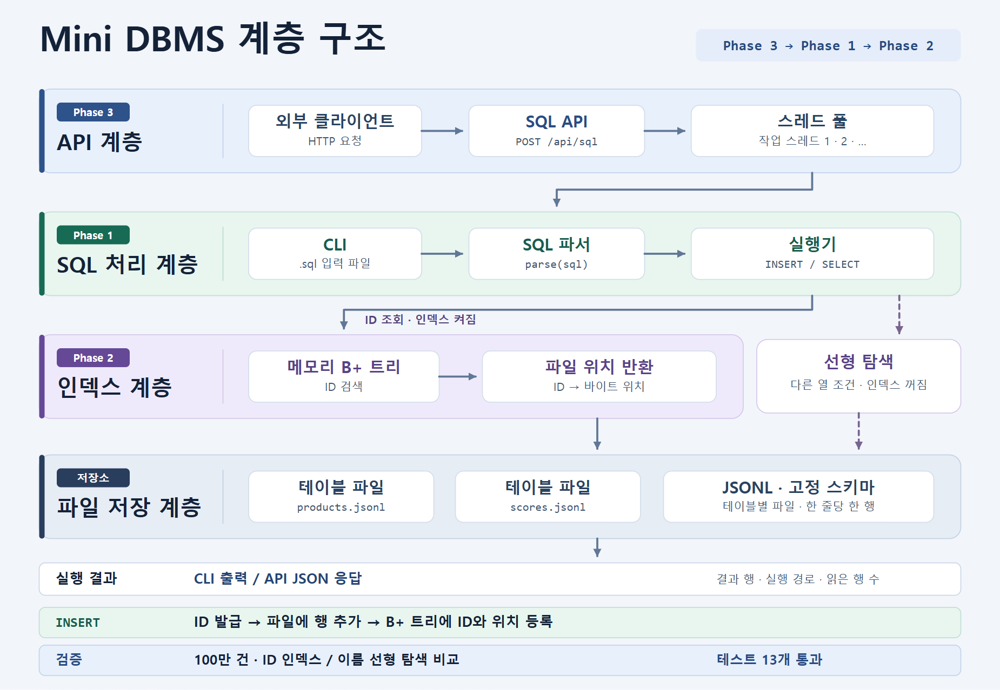

# Mini DBMS

SQL을 직접 해석하고 테이블 파일에 행을 저장하는 Python 기반 데이터베이스입니다.

API에서 인덱스를 사용하는 ID 조회는 **Phase 3 스레드 풀 → Phase 1 SQL 처리기 → Phase 2 B+ 트리** 순서로 이어집니다. B+ 트리는 행이 있는 파일 위치를 반환합니다. 인덱스가 적용되지 않는 조회는 테이블 파일을 순서대로 읽습니다. CLI로 `.sql` 파일을 실행하면 Phase 1의 같은 SQL 처리기로 들어갑니다.

## 바로 실행하기

~~~powershell
cd mini-dbms
python -m mini_dbms.cli examples/demo.sql
~~~

[전체 실행 방법과 API 예제](mini-dbms/README.md) · [100만 건 성능 비교 결과](mini-dbms/reports/benchmark.json)
